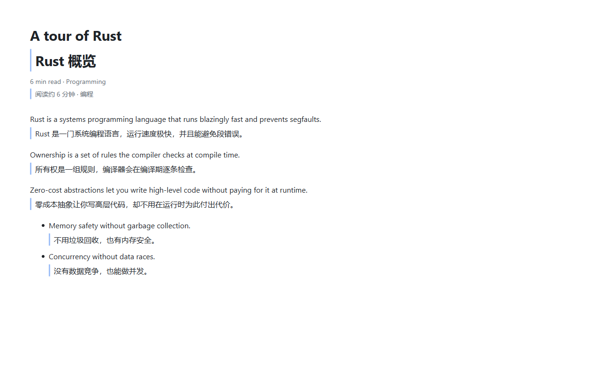
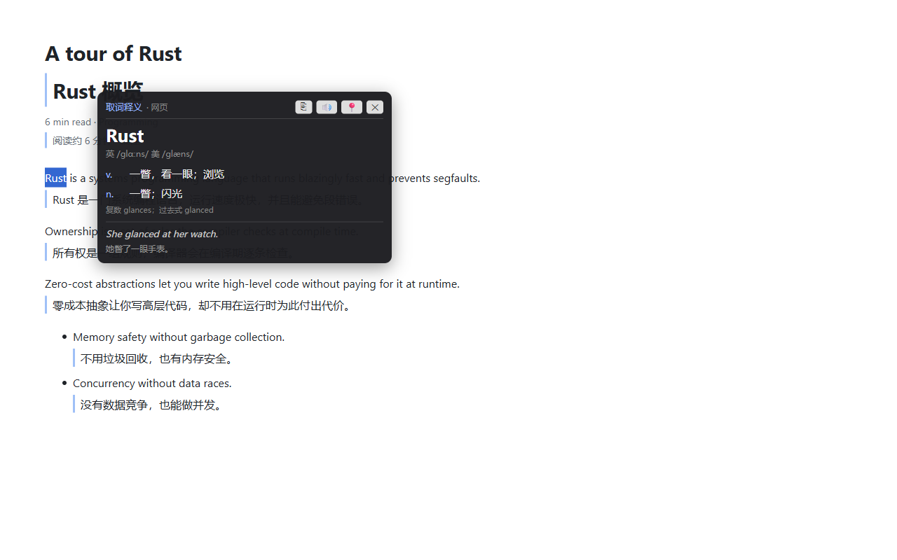
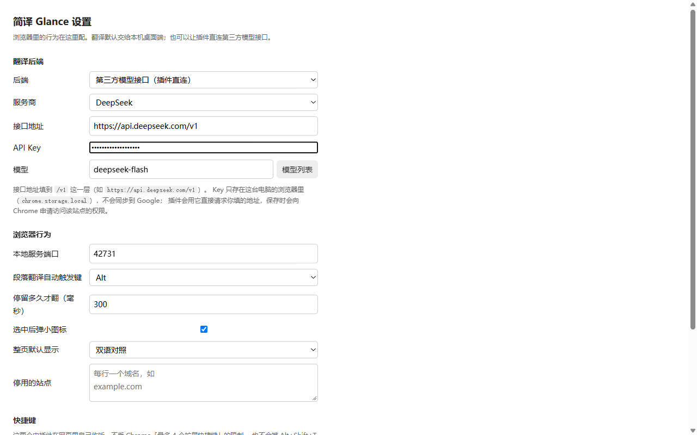

# 简译 Glance

Windows 上的翻译工具：**一个桌面端 + 一个 Chrome 插件**，翻译交给大模型。
目标语言固定简体中文，源语言自动识别，中文段落自动跳过。



## 能做什么

### 桌面端（Windows，Rust + egui）

- **任意窗口划词取词**——浏览器、终端、PDF 阅读器都能取到字（走无障碍接口，取不到就退回截图识别）
- **框选屏幕区域翻译**——译文按行盖回原位置，可点击切换原文/译文
- **取到单个词给词典卡**——音标、词性、常见释义、词形变化、例句与例句翻译
- **术语表对照**——固定术语在提示词里约束模型
- **朗读**——Windows 的语音合成，中英文音色一致
- **实时字幕**（可选组件）——本地 whisper 识别 + 翻译，会议/直播场景用
- **生词库**——查过的单词自动入库，每天随机抽一组考你

### Chrome 插件（TypeScript，MV3）



- **整页翻译**——按文档顺序分批流式上屏，可切「双语对照 / 仅译文 / 原文」
- **悬停翻译**——按住 Ctrl（可改）停在段落上，译文插在段落下
- **划词翻译**——选中文字弹「译」图标；选中单个词时给的是词典卡
- **格式与公式保留**——读页面里真正的文字，不做截图识别，链接、加粗、已渲染的公式都留着

## 两种后端

插件与桌面端都能选走哪条路：

| | 本机桌面端 | 直连模型接口 |
|---|---|---|
| 谁请求模型 | 桌面端服务（只监听 127.0.0.1） | 插件自己请求 |
| API Key 放哪 | 桌面端配置文件，**不进浏览器** | 浏览器扩展的本地存储（`chrome.storage.local`，不参与账号同步） |
| 离线词库 | 有（查单词先秒出本地释义） | 没有 |
| 适合 | 自己的电脑、机密页面 | 只想装插件、多个设备用 |

直连模式支持任何 OpenAI 兼容的服务（DeepSeek、OpenAI、通义千问、智谱、Kimi、硅基流动……），
设置页里有现成预设，也能填自己的地址。



## 安装

- **桌面端**：[Releases](https://github.com/jackTbig/translate-tool/releases) 里下载 `简译Glance-setup-<版本>.exe`
  （约 684 MB，含实时字幕组件与两个语音识别模型；不装字幕的话体积会小很多）
- **Chrome 插件**：Chrome 应用商店（审核中）；也可以从 [Releases](https://github.com/jackTbig/translate-tool/releases)
  下载 `glance-extension-<版本>.zip` 解压后在 `chrome://extensions` 里「加载已解压的扩展程序」
  （注意：商店版与解压版是不同的扩展，ID 不一样）

## 从源码构建

需要 Rust 1.95+、Node 18+、Python 3.10+。

```bash
# 桌面端
cargo build --release -p translate-tool

# Chrome 插件（在 extension/ 下）
cd extension && npm install && npm run build && npm test

# 打成商店上传用的 ZIP
python scripts/package_extension.py

# 打成安装包（需要 Inno Setup）
bash scripts/build_installer.sh            # 只打简译
bash scripts/build_installer.sh --with-caption   # 连实时字幕与模型一起
```

仓库结构：

```
crates/ai-translate/    翻译核心：场景提示词、并发池、批量、重试、术语表
crates/desktop-shell/   两个应用共用的桌面基建：托盘、热键、DPI、日志、字体
crates/text-capture/    Windows 取词：划词、无障碍接口、截图 OCR
crates/offline-dict/    离线词库（ECDICT 编译成二进制）
apps/desktop/           桌面端：egui 界面 + 本地 HTTP 服务 + 生词库
apps/caption/           实时字幕（本地 whisper 识别）
extension/              Chrome MV3 插件
tests/mock-llm/         OpenAI 兼容的假后端，供集成测试与端到端测试用
tests/e2e/              Playwright 端到端（真浏览器 + 真插件）
```

## 隐私

- 不收集、不上报任何数据，没有统计、没有广告、没有后台
- 页面文字只发给你自己指定的模型服务商，或你自己的本机服务
- 走桌面端时，连 API Key 都不需要交给浏览器
- 插件的本地服务只监听 `127.0.0.1`，且只接受浏览器扩展来源的请求

详见[隐私政策](docs/index.html#privacy)。

## 第三方组件

| 组件 | 用途 | 许可 |
|---|---|---|
| [KaTeX](https://katex.org/) | 网页里的 LaTeX 公式渲染 | MIT |
| [ECDICT](https://github.com/skywind3000/ECDICT) | 离线英汉词库 | MIT |
| [whisper.cpp](https://github.com/ggerganov/whisper.cpp) | 实时字幕的本地语音识别 | MIT |

完整清单见 [`docs/第三方组件授权.md`](docs/第三方组件授权.md)。

## 许可

[MIT](LICENSE)
